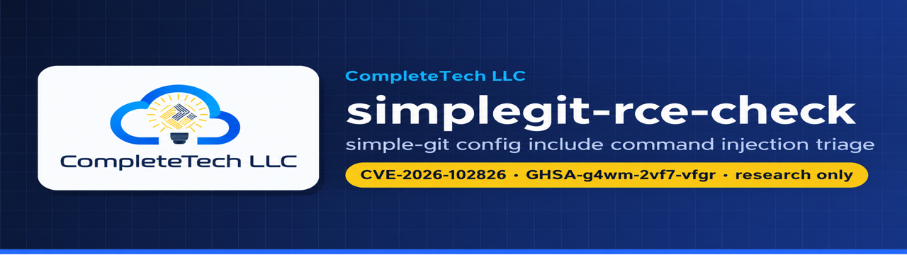
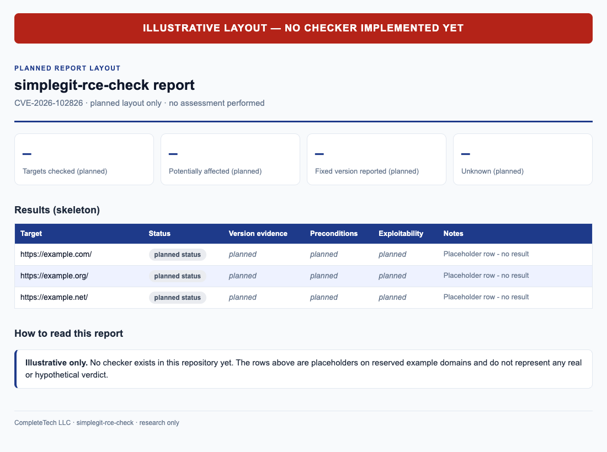

  

  
  
  

  <b>simple-git configuration include command injection</b> 
  CVE-2026-102826 · GHSA-g4wm-2vf7-vfgr · research only

---

> **Repository initialized; checker implementation pending.**
> This project currently contains research and an implementation checklist.
> It does not assess systems or provide an executable detection rule.

`simplegit-rce-check` is the planned checker for **CVE-2026-102826**, a command injection in the `simple-git` npm package that is reachable through Git configuration includes. By [CompleteTech LLC](https://complete.tech).

## One exploit, one repository

| Field | Scope |
| --- | --- |
| Exploit identifier | `CVE-2026-102826` |
| Aliases for this same exploit | `GHSA-g4wm-2vf7-vfgr` |
| Research verification date | 2026-10-23 |
| Implementation state | `planned` |
| Detection rule | **Disabled — research only** |

This repository is dedicated to **CVE-2026-102826**. Aliases and multiple affected
products identify this same exploit; they do not create additional scanner scopes.
Future fixes for different vulnerabilities belong in independent repositories.

## Status and what is planned

There are no checker commands, install steps, downloadable binaries, test results, or CI
workflow yet. Progress is tracked in the [implementation checklist](docs/IMPLEMENTATION.md).

1. Review [advisory.json](advisory.json) and the [primary sources](#primary-sources).
2. Work through the exploit-specific [implementation checklist](docs/IMPLEMENTATION.md).
3. Read [AGENTS.md](AGENTS.md), [CONTRIBUTING.md](CONTRIBUTING.md), and
   [SECURITY.md](SECURITY.md) before contributing.

## Planned report layout

The planned checker is meant to produce human-readable findings alongside JSON/CSV. The image below is an **illustrative layout only**: no checker exists, and every row is a placeholder.

  <picture>
    <source media="(prefers-color-scheme: dark)" srcset="docs/images/report-dark.png">
    
  </picture>

ILLUSTRATIVE, NOT A REAL REPORT. Placeholder rows on reserved <code>example.*</code> domains; no verdicts are shown.

## What the results will mean (planned)

This vocabulary is **planned**, taken from the repository's own [AGENTS.md](AGENTS.md) and [implementation checklist](docs/IMPLEMENTATION.md). Nothing emits it yet.

| Status | Planned meaning |
| --- | --- |
| `potentially_affected` | Evidence matches this advisory's documented range or condition. Not confirmed exploitability. |
| `fixed_version_reported` | A supported comparison meets the fix. Not a guarantee or verified deployed patch. |
| `unknown` | Missing, malformed, conflicting, prerelease, vendor/custom-build, possible-backport, or uncovered versions. |

Exploitability will remain `exploitability: not_tested` for every finding.

| Fix-version research (not a detection rule) | Value |
| --- | --- |
| Affected range reported by the advisory | `<=3.36.0` |
| Fix reported by the advisory | `4.0.0` |

> [!IMPORTANT]
> **Research only.** The values above come from the advisory research record and are not an implemented rule. Versions between `3.36.0` and `4.0.0` must not be assumed affected, and a reported fix is not a guarantee. Potential exposure is not confirmed exploitability.

## Advisory snapshot

The following is source-backed research for implementation planning. It is not a
test result, a live rule feed, or an attestation that a deployed system is patched.

### Affected versions or conditions

<=3.36.0

### Reported fixes or remediation

4.0.0

### Deployment preconditions to establish

- attacker influence over clone/mirror customArgs
- attacker-controlled readable Git configuration file
- remote operation loads unsafe configuration

### Evidence notes and limitations

- Do not invent affected status for hypothetical versions between 3.36.0 and 4.0.0. File-pattern findings show review targets, not proven input taint. include.path and includeIf variants share this advisory.

## How it will work (planned)

The intended checker follows the evidence and reporting conventions of
[node2shell-check](https://github.com/CompleteTech-LLC/node2shell-check) and [php2shell-check](https://github.com/CompleteTech-LLC/php2shell-check):

- Prefer offline version, inventory, or configuration evidence appropriate to this exploit.
- Keep version state, documented preconditions, evidence provenance, and uncertainty separate.
- Preserve `exploitability: not_tested`; never run exploit payloads or confirm compromise.
- Keep missing, malformed, conflicting, vendor-qualified, prerelease, and uncovered versions `unknown`.
- Produce human-readable findings and machine-readable JSON/CSV; document each output before release.
- Add bounded, explicitly selected passive network behavior only if it provides useful evidence.

These capabilities are **planned**, not implemented. There are currently no
checker commands, downloadable binaries, test results, or CI claims.

## Primary sources

1. [github.com](https://github.com/steveukx/git-js/security/advisories/GHSA-g4wm-2vf7-vfgr)
2. [github.com](https://github.com/advisories/GHSA-g4wm-2vf7-vfgr)

The research date records the supplied verification snapshot. Recheck primary
advisories before enabling any detection logic, and retain contradictory evidence.

## Documentation

- [Implementation checklist](docs/IMPLEMENTATION.md)
- [advisory.json](advisory.json): source-preserving research record
- [Contributing](CONTRIBUTING.md) · [Security policy](SECURITY.md) · [Agent instructions](AGENTS.md)

## License

[AGPL-3.0](LICENSE), or a separate commercial agreement with CompleteTech LLC.
See [LICENSING.md](LICENSING.md) and the
[contribution terms](CONTRIBUTING.md#licensing-of-contributions).
Names and branding are governed by [BRAND_ASSETS.md](BRAND_ASSETS.md).

Copyright © 2026 CompleteTech LLC.
